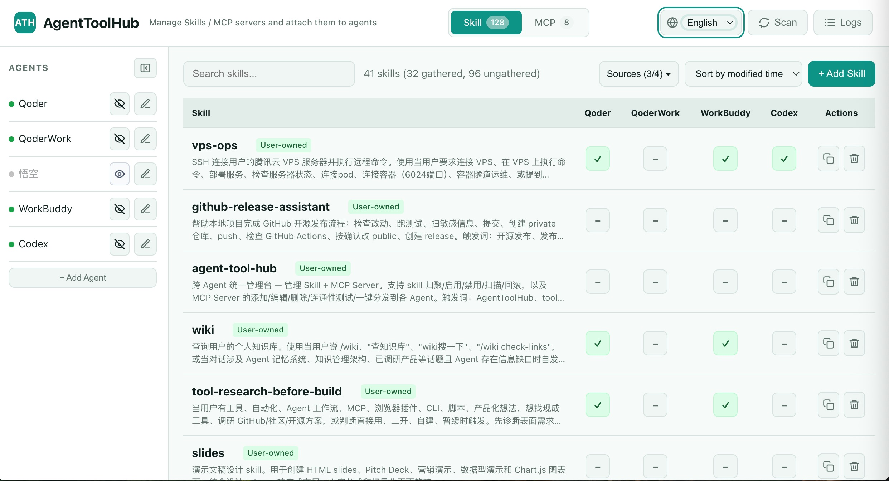
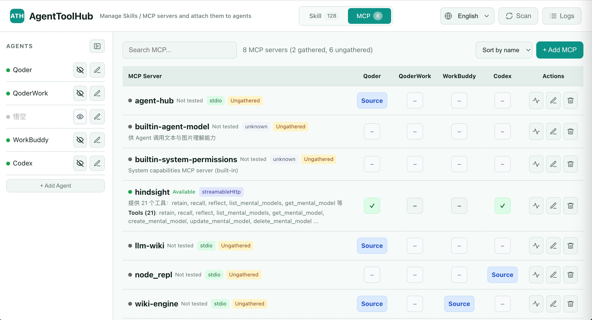

# AgentToolHub

Local-first Web control panel for AI agent tools, Skills, and MCP servers.

**English** · [简体中文](./README.zh-CN.md) · [中文快速上手](./QUICKSTART.zh-CN.md)

AgentToolHub helps you manage local AI agent capabilities without scattering Skills and MCP server configs across multiple agent directories. The recommended way to use it is through the local Web UI. The CLI is mainly for advanced users, scripting, and debugging.

The Web UI gives you a local, auditable workflow: scan, gather, link, unlink, toggle, and test tools before exposing them to agents.

## Why

- Manage local AI agent Skills and MCP servers in one place.
- Use a Web UI instead of editing scattered config files by hand.
- Link, unlink, gather, and audit local tools safely.
- Run locally by default on `127.0.0.1`.

## Status

AgentToolHub is currently packaged as a local developer utility. The public package and command names use `agent-tool-hub`. Internal Python imports still use `tool_hub` in v0.1.0 for compatibility.

## Screenshots

### Skill Management



### MCP Management



## Web UI Quick Start

Fastest path on macOS:

1. Download and unzip the project archive.
2. Open the project folder.
3. Double-click `run.command`.
4. Open `http://127.0.0.1:8998` if the browser does not open automatically.

If macOS does not allow double-click execution, run this once in the project folder:

```bash
chmod +x run.command
```

Cross-platform source-tree start:

```bash
python3 tool_hub_server.py
```

Then open:

```text
http://127.0.0.1:8998
```

Optional install from the source tree:

```bash
pip install .
```

After installation, start the local Web UI:

```bash
agent-tool-hub-web --host 127.0.0.1 --port 8998
```

You can also start it from the CLI entry:

```bash
agent-tool-hub web
```

## What You Can Do in the Web UI

- View configured agents, Skills, and MCP servers.
- Gather local Skill directories into a central managed location.
- Enable or disable Skills for different agents.
- Add, edit, and test MCP server configs.
- Inspect MCP tool lists before exposing them to agents.
- Keep local config writes auditable and backed up.

## Advanced CLI Usage

The CLI is useful for scripting, debugging, and automation. Most users should start from the Web UI.

```bash
agent-tool-hub --help
agent-tool-hub doctor
agent-tool-hub agents list
agent-tool-hub mcp list
agent-tool-hub mcp test --name playwright --no-exec
agent-tool-hub skills gather --name demo --from /abs/path/demo --agent-id codex
agent-tool-hub skills toggle --skill-id demo --agent-id cursor
```

Legacy command aliases are kept for migration:

```bash
agent-tool-dock --help
agent-tool-dock-web --host 127.0.0.1 --port 8998 --no-browser
tool-hub --help
tool-hub-web --host 127.0.0.1 --port 8998 --no-browser
```

## What It Manages

- Built-in agent presets and MCP adapter rules.
- Local Skill directories.
- MCP server definitions and adapter configs.
- Link-based Skill enable / disable state: symlink on macOS / Linux, directory junction on Windows.
- JSON / TOML agent configuration writes with backups.

## Safety Model

AgentToolHub is designed for a single trusted user on a local machine.

- The web server listens on `127.0.0.1` by default.
- CORS is limited to localhost / `127.0.0.1` origins.
- It reads local Skill directories and MCP configuration files.
- It may create / remove managed directory links.
- On macOS / Linux, Skill links use symlinks.
- On Windows, Skill links use directory junctions via `mklink /J` where possible.
- It may write JSON / TOML config files.
- Config files are backed up before writes.
- MCP `env` / `headers` values are not encrypted at rest.
- `fetch_tools=false` is the default safety value; stdio MCP tools are not auto-fetched by default.

Do not expose AgentToolHub directly to the public internet. See [`SECURITY.md`](SECURITY.md).

## Boundaries

Current boundaries:

- No multi-user authentication.
- No public SaaS deployment model.
- No secret vault for MCP `env` / `headers`.
- macOS is the primary tested platform.
- Windows support is experimental and mechanism-supported, but not verified with a real Windows end-to-end test run.
- Windows junction handling has a compatibility layer, but Windows workflows should be manually validated before being advertised as fully supported.

## Windows Link Support

AgentToolHub uses managed directory links to enable / disable Skills inside agent-specific Skill directories. On macOS and Linux this is implemented with symlinks. On Windows, AgentToolHub uses directory junctions via `cmd /c mklink /J <link> <target>` where possible.

Rationale:

- AgentToolHub only needs to link directories, not individual files.
- Microsoft documents `mklink /J` as the command option for creating a Directory Junction, while `mklink /D` creates a directory symbolic link.
- Microsoft documents junctions as directory links that can point to directories on different local volumes on the same computer, but not to mapped network volumes or files.
- Windows symbolic links can work, but symlink creation may depend on Developer Mode, elevation, or local security policy. Junctions are a more compatible default for this project because the managed Skill target is a local directory.

Expected Windows behavior:

- Local NTFS folders are the intended target.
- Cross-drive local folders should be viable for junctions.
- Mapped network drives are not supported for junction targets.
- File links are not supported by AgentToolHub's Skill linking model.
- Junction removal should remove only the managed link, not the central Skill directory.

Validation status:

- The compatibility layer is covered by automated tests and POSIX-side behavior checks.
- Windows-specific behavior has been evaluated against Microsoft documentation, but has not been manually tested on a real Windows machine.
- Until a real Windows workflow is tested, Windows support should be described as experimental rather than fully supported.

References:

- Microsoft Learn: `mklink` command — https://learn.microsoft.com/en-us/windows-server/administration/windows-commands/mklink
- Microsoft Learn: Hard links and junctions — https://learn.microsoft.com/en-us/windows/win32/fileio/hard-links-and-junctions
- Microsoft Learn: Creating symbolic links — https://learn.microsoft.com/en-us/windows/win32/fileio/creating-symbolic-links
- Windows Developer Blog: Symlinks in Windows 10 — https://blogs.windows.com/windowsdeveloper/2016/12/02/symlinks-windows-10/

## HTTP Surface

Main endpoints:

- `GET /api/config`
- `PUT /api/config`
- `GET /api/agents`
- `GET /api/skills`
- `POST /api/skills/upload`
- `POST /api/gather`
- `POST /api/skills/<id>/toggle`
- `POST /api/mcp/<name>/test`

## Validation

```bash
python3 -m unittest discover -s tests -v
```

Current tests cover:

- services: `ConfigService`, `UploadSkillService`, Skill, MCP, Audit
- CLI flows: `agents list`, `mcp test --no-exec`, `skills gather`, `skills toggle`
- HTTP flows: config, agents, skills upload
- docs and packaging assertions: `README.md`, `QUICKSTART.zh-CN.md`, `pyproject.toml`

## Developer Compatibility Notes

The public project name is `AgentToolHub` and the package name is `agent-tool-hub`.

For v0.1.0 compatibility:

- Internal Python imports remain `tool_hub`.
- The source-tree web entry remains `python3 tool_hub_server.py`.
- Direct module commands remain available, for example `python3 -m tool_hub.cli doctor`.
- Legacy CLI commands `agent-tool-dock`, `agent-tool-dock-web`, `tool-hub`, and `tool-hub-web` remain available.
- Existing local config files such as `tool-hub.json` are not renamed automatically in this pass.
- The built-in presets and adapters are packaged under `tool_hub/data/`.
- Developer checks can still use `python3 -m compileall tool_hub` and `python3 -m py_compile tool_hub_server.py`.

Minimal source layout:

```text
agent-tool-hub/
  pyproject.toml
  tool_hub/                 # internal Python package kept for compatibility
    cli.py
    server.py
    http_app.py
    linking.py
    services/
    mcp/
    data/
      agent-presets/
      mcp-adapters/
  tests/
  tool_hub_server.py
```

## License

MIT License. See [`LICENSE`](LICENSE).
