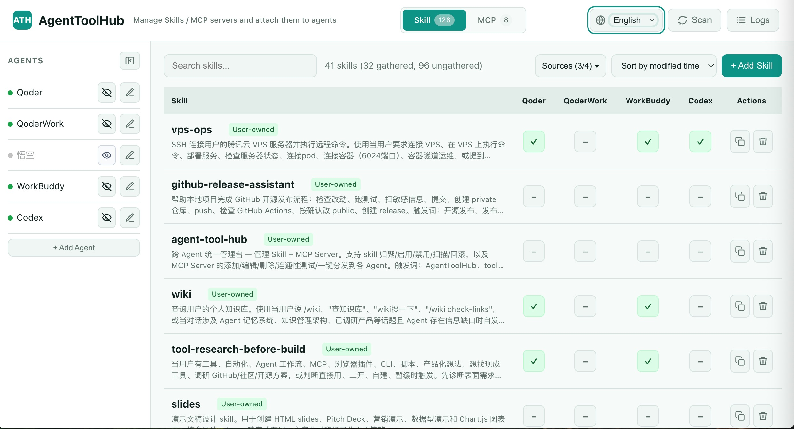
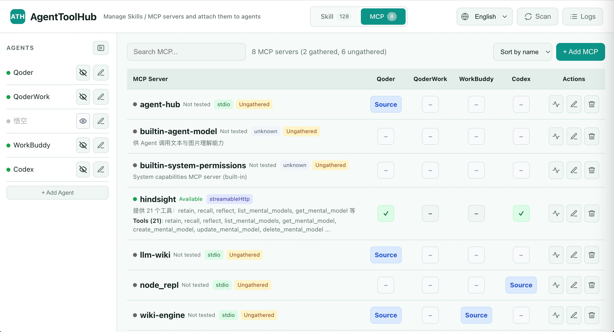

# AgentToolHub

本地优先的 AI Agent 工具、Skills 与 MCP 服务器 Web 控制台。

[English](./README.md) · **简体中文** · [中文快速上手](./QUICKSTART.zh-CN.md)

AgentToolHub 帮你统一管理本机 AI Agent 能力，不必再把 Skills 和 MCP 服务器配置散落写在多个 agent 目录里。推荐通过本地 Web UI 使用；CLI 主要面向进阶用户、脚本与调试场景。

Web UI 提供一套本地、可审计的工作流：扫描、收集、链接、取消链接、开关、测试，然后再把工具暴露给 agent。

## 为什么

- 在一处管理本机 AI agent 的 Skills 与 MCP 服务器。
- 用 Web UI 替代手工编辑散落各处的配置文件。
- 安全地对本地工具做链接、取消链接、收集与审计。
- 默认只在本机 `127.0.0.1` 上运行。

## 状态

AgentToolHub 目前以本地开发者工具形态发布。公开包名与命令名使用 `agent-tool-hub`；v0.1.0 内部 Python 导入仍为 `tool_hub`（兼容考虑）。

## 截图

### Skill 管理



### MCP 管理



## Web UI 快速开始

macOS 上最快的路径：

1. 下载并解压项目归档。
2. 打开项目文件夹。
3. 双击 `run.command`。
4. 浏览器未自动打开时，访问 `http://127.0.0.1:8998`。

如果 macOS 不允许双击执行，在项目文件夹里运行一次：

```bash
chmod +x run.command
```

跨平台源码启动：

```bash
python3 tool_hub_server.py
```

然后打开：

```text
http://127.0.0.1:8998
```

可选：从源码树安装：

```bash
pip install .
```

安装后启动本地 Web UI：

```bash
agent-tool-hub-web --host 127.0.0.1 --port 8998
```

也可以通过 CLI 入口启动：

```bash
agent-tool-hub web
```

更详细的中文上手说明见 [`QUICKSTART.zh-CN.md`](QUICKSTART.zh-CN.md)。

## Web UI 能做什么

- 查看已配置的 agents、Skills 与 MCP 服务器。
- 把本地 Skill 目录收集到集中托管位置。
- 为不同 agent 启用或停用 Skills。
- 新增、编辑、测试 MCP 服务器配置。
- 在暴露给 agent 之前检查 MCP 工具列表。
- 本地配置写入全程可审计、有备份。

## 高级 CLI 用法

CLI 适合脚本、调试与自动化。大多数用户应从 Web UI 开始。

```bash
agent-tool-hub --help
agent-tool-hub doctor
agent-tool-hub agents list
agent-tool-hub mcp list
agent-tool-hub mcp test --name playwright --no-exec
agent-tool-hub skills gather --name demo --from /abs/path/demo --agent-id codex
agent-tool-hub skills toggle --skill-id demo --agent-id cursor
```

为迁移保留的旧命令别名：

```bash
agent-tool-dock --help
agent-tool-dock-web --host 127.0.0.1 --port 8998 --no-browser
tool-hub --help
tool-hub-web --host 127.0.0.1 --port 8998 --no-browser
```

## 它管理什么

- 内置 agent 预设与 MCP adapter 规则。
- 本地 Skill 目录。
- MCP 服务器定义与 adapter 配置。
- 基于链接的 Skill 启停状态：macOS / Linux 用符号链接，Windows 用目录 junction。
- JSON / TOML agent 配置写入，写前备份。

## 安全模型

AgentToolHub 面向单机、单一可信用户设计。

- Web 服务默认监听 `127.0.0.1`。
- CORS 仅限 localhost / `127.0.0.1` 来源。
- 会读取本地 Skill 目录与 MCP 配置文件。
- 可能创建 / 删除托管目录链接。
- macOS / Linux 上 Skill 链接使用符号链接。
- Windows 上尽可能通过 `mklink /J` 创建目录 junction。
- 可能写入 JSON / TOML 配置文件。
- 配置文件写入前均有备份。
- MCP 的 `env` / `headers` 值不以加密形式落盘。
- `fetch_tools=false` 是默认安全值；stdio MCP 工具默认不自动拉取。

不要把 AgentToolHub 直接暴露到公网。见 [`SECURITY.md`](SECURITY.md)。

## 边界

当前边界：

- 无多用户认证。
- 无公有 SaaS 部署模式。
- 无 MCP `env` / `headers` 的密钥保险库。
- macOS 为主要测试平台。
- Windows 支持处于实验阶段：机制上支持，但未在真实 Windows 上跑过端到端验证。
- Windows junction 处理有兼容层，但对外宣称完整支持前应先做 Windows 流程人工验证。

## Windows 链接支持

AgentToolHub 用托管目录链接在各 agent 的 Skill 目录中启用 / 停用 Skills。macOS 与 Linux 上使用符号链接；Windows 上尽可能通过 `cmd /c mklink /J <link> <target>` 创建目录 junction。

设计理由：

- AgentToolHub 只需要链接目录，不需要链接单个文件。
- 微软文档中 `mklink /J` 创建的是目录 junction，而 `mklink /D` 创建的是目录符号链接。
- 微软文档说明 junction 可指向同一台机器上不同本地卷的目录，但不能指向映射的网络卷或文件。
- Windows 符号链接需要开发者模式、提权或本地安全策略，junction 对本项目更兼容，因为托管 Skill 目标就是本地目录。

预期的 Windows 行为：

- 目标为本地 NTFS 文件夹。
- 跨盘符本地文件夹对 junction 应当可行。
- 映射网络驱动器不支持作为 junction 目标。
- AgentToolHub 的 Skill 链接模型不支持文件链接。
- 移除 junction 只移除托管链接，不动中央 Skill 目录。

验证状态：

- 兼容层有自动化测试与 POSIX 侧行为检查覆盖。
- Windows 行为对照微软文档做过评估，但未在真实 Windows 机器上人工验证。
- 在完成真实 Windows 流程验证之前，Windows 支持应标注为实验性。

参考资料：

- Microsoft Learn: `mklink` command — https://learn.microsoft.com/en-us/windows-server/administration/windows-commands/mklink
- Microsoft Learn: Hard links and junctions — https://learn.microsoft.com/en-us/windows/win32/fileio/hard-links-and-junctions
- Microsoft Learn: Creating symbolic links — https://learn.microsoft.com/en-us/windows/win32/fileio/creating-symbolic-links
- Windows Developer Blog: Symlinks in Windows 10 — https://blogs.windows.com/windowsdeveloper/2016/12/02/symlinks-windows-10/

## HTTP 接口

主要端点：

- `GET /api/config`
- `PUT /api/config`
- `GET /api/agents`
- `GET /api/skills`
- `POST /api/skills/upload`
- `POST /api/gather`
- `POST /api/skills/<id>/toggle`
- `POST /api/mcp/<name>/test`

## 验证

```bash
python3 -m unittest discover -s tests -v
```

当前测试覆盖：

- services：`ConfigService`、`UploadSkillService`、Skill、MCP、Audit
- CLI 流程：`agents list`、`mcp test --no-exec`、`skills gather`、`skills toggle`
- HTTP 流程：config、agents、skills upload
- 文档与打包断言：`README.md`、`QUICKSTART.zh-CN.md`、`pyproject.toml`

## 开发者兼容说明

公开项目名为 `AgentToolHub`，包名为 `agent-tool-hub`。

v0.1.0 兼容性：

- 内部 Python 导入保持 `tool_hub`。
- 源码树 Web 入口保持 `python3 tool_hub_server.py`。
- 模块直调命令保持可用，例如 `python3 -m tool_hub.cli doctor`。
- 旧 CLI 命令 `agent-tool-dock`、`agent-tool-dock-web`、`tool-hub`、`tool-hub-web` 保持可用。
- 已有本地配置文件（如 `tool-hub.json`）不在本阶段自动改名。
- 内置预设与 adapters 打包在 `tool_hub/data/` 下。
- 开发者检查仍可用 `python3 -m compileall tool_hub` 与 `python3 -m py_compile tool_hub_server.py`。

最小源码结构：

```text
agent-tool-hub/
  pyproject.toml
  tool_hub/                 # 为兼容保留的内部 Python 包
    cli.py
    server.py
    http_app.py
    linking.py
    services/
    mcp/
    data/
      agent-presets/
      mcp-adapters/
  tests/
  tool_hub_server.py
```

## 许可

MIT License。见 [`LICENSE`](LICENSE)。